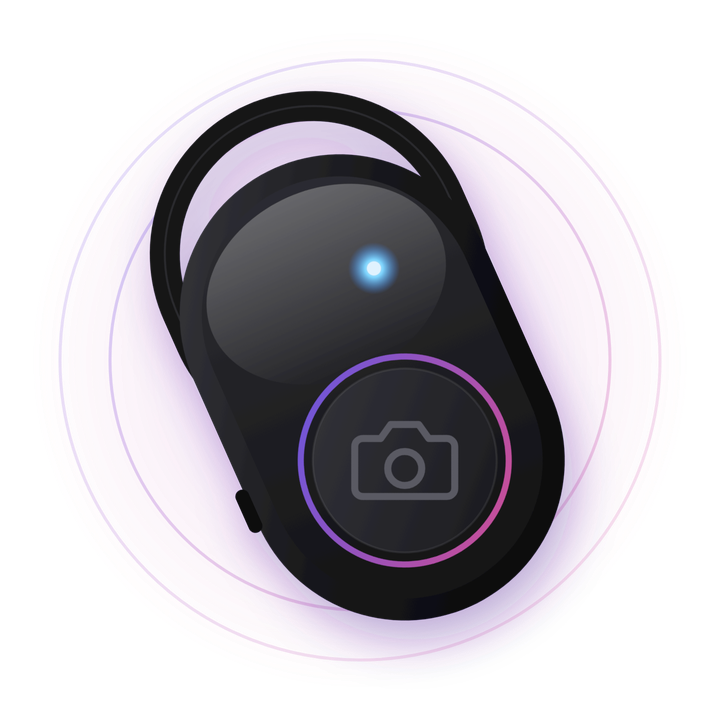
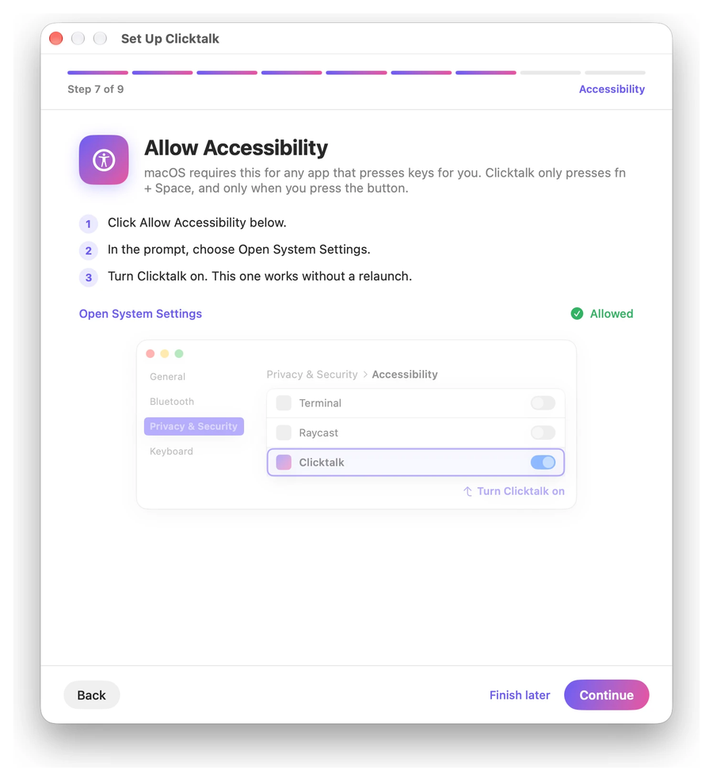
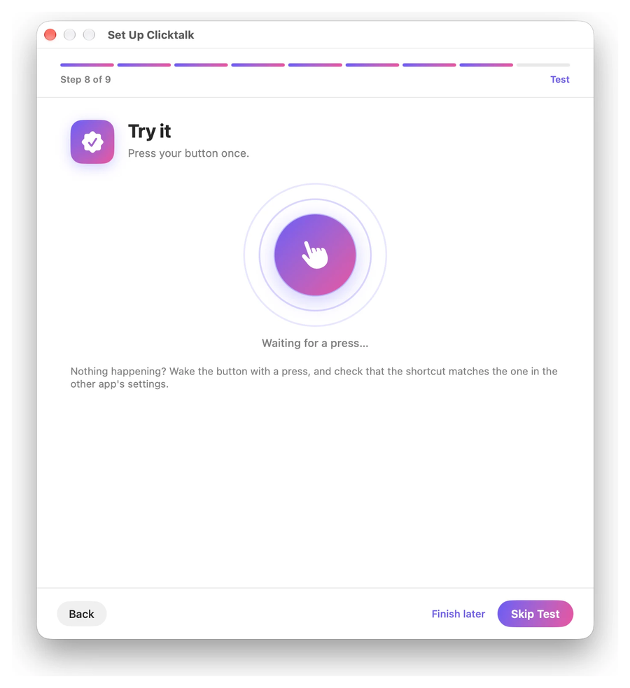

# Clicktalk

Turn a cheap Bluetooth button into a key for your Mac. Hold it to talk to your dictation app,
tap it to summon a chat app, or run any Shortcut.

<p align="center"></p>

Clicktalk is a small menu bar app. It takes hold of your Bluetooth clicker, so the key the clicker
sends (often Volume Up) never reaches other apps. Then it runs the action you chose. A setup
guide walks you through every macOS permission and shows when each one is on.

## The button

<p align="center"></p>

Clicktalk was built and tested with a cheap Bluetooth camera-shutter remote like the one above,
the kind sold for taking selfies with a phone. Presentation clickers and other small Bluetooth
remotes work the same way.

In the screenshots below the remote appears as **BT1818**. That is the name its Bluetooth chip
reports when it pairs, so it is what you see in Bluetooth settings and in Clicktalk's list of
devices. macOS treats the remote as an HID device: a tiny keyboard that sends one key, usually
Volume Up. Your remote may report a different name, such as AB Shutter3. Clicktalk does not care
about the name or the key; it learns whichever your remote sends.

## What Clicktalk does, and what it needs

**Clicktalk does not transcribe or chat by itself.** It turns a button press into a keystroke,
an app launch, a Shortcut, a link or a command. The work happens in another app that you
already use. For voice input that is a dictation app, for example:

- [Handy](https://github.com/cjpais/Handy), free and open source. Clicktalk was built and tested
  with it.
- Superwhisper, Wispr Flow, MacWhisper or similar apps that start dictation from a shortcut.

Any app works if it can be started with a keyboard shortcut, a link or a Shortcut.

### The shortcut must be a global shortcut

Clicktalk presses keys the same way your keyboard does. For this to work while you are in
another app, the target app's shortcut must be a **global shortcut**: one the app registers
system-wide, so it works even when that app is not in front.

1. Open the target app's settings and find its global shortcut. Dictation apps usually call it
   the recording, transcription or push-to-talk shortcut.
2. Pick a combination that no other app uses, for example `fn + Space` or `⌥ + Space`.
3. In Clicktalk, record exactly that combination.
4. Match how the app behaves:
   - The app records while the key is held: choose **Push-to-talk** (Hold).
   - The app starts on one press and stops on the next: choose **Tap to start and stop**.

Shortcuts that only work while their app is in front, such as menu shortcuts, will not work
from the button. Clicktalk can only trigger what the target app listens for globally.

### How this started: Karabiner-Elements

Clicktalk began as a [Karabiner-Elements](https://github.com/pqrs-org/Karabiner-Elements) setup.
Karabiner remapped the clicker's key to the dictation shortcut, and that setup kept breaking
after reconnects and macOS updates. Clicktalk replaces it with one app. It takes hold of the
button itself and shows which part failed when something stops working.

You do not need Karabiner-Elements. If you have it installed, it can keep running for your other
keyboards. Turn off **Modify events** for the button in Karabiner-Elements > Devices, so that
Clicktalk can take hold of it.

## Before you start

- macOS 13 or later.
- The Xcode command line tools: `xcode-select --install`.
- A Bluetooth button paired with your Mac in System Settings > Bluetooth. Camera shutter
  remotes and presentation clickers work.
- Your target app installed, with a global shortcut set as described above.

## Install

Clone or download this repository, then run this in its folder:

```bash
./build.sh
```

`build.sh` compiles the app, installs it in `/Applications` and opens it. The setup guide opens on
first launch.

## Set up, step by step

The guide has nine steps. Each one checks itself, and **Continue** lights up as soon as macOS
reports the step done. You can close the guide and pick up later from the menu bar dot under
**Setup Guide**.

### 1. Welcome

The guide lists what you need. If Clicktalk is not in Applications, it offers to copy itself there
first. macOS ties permissions to the app's location, so do this before granting anything.


### 2. Allow Bluetooth

Click **Allow Bluetooth**, then **Allow** in the macOS prompt. Clicktalk only uses this to see
whether your button is connected or asleep.


### 3. Choose your button

Press your button once. Most clickers connect only when pressed, so it moves to **Connected now**.
Select it. Here the remote is **BT1818**; the names of other paired devices are blurred.

<p align="center"></p>

### 4. Allow Input Monitoring

1. Click **Allow Input Monitoring**.
2. In the macOS prompt, choose **Open System Settings**.
3. Turn Clicktalk on.
4. If macOS asks to quit and reopen Clicktalk, choose **Later**, then click **Relaunch Clicktalk** in
   the guide. It reopens on the same step.

When the step is done, a green note says that Clicktalk now holds your button.

<p align="center"></p>

### 5. Press your button

Press the button once. Clicktalk learns which key the button sends, for example Volume Up, and shows
its name. Every clicker is different, so this replaces any device list.


### 6. Choose what it does

Pick a starting point, then fill in the details:

- **Push-to-talk dictation.** Record the dictation app's global shortcut. The key stays down while
  you hold the button.
- **Tap to start and stop.** Same, as a single tap.
- **Summon an app.** Pick the app. A second press hides it.
- **Run a Shortcut.** Pick one from the Shortcuts app.
- **Something else.** A link or a shell command.

To record a shortcut, click **Record Shortcut** and press the combination. The target app reacts once
while you record it; that is expected. You can also click **Type it instead** and write it, for
example `fn+space` or `right option`.

<p align="center"></p>

### 7. Allow Accessibility

Only needed when the button presses keys. Click **Allow Accessibility**, choose **Open System
Settings** in the prompt, and turn Clicktalk on. For other actions the step says it is not needed.

<p align="center"></p>

### 8. Try it

Press the button. For push-to-talk, hold it, speak, then let go. The step turns green with
**It works**, and shows what the press did. If nothing happens, wake the button with a press, and
check that the recorded shortcut matches the target app's global shortcut.

<p align="center"></p>

### 9. Done

Turn on **Open Clicktalk at login** so the button works right after you log in.

<p align="center"></p>

## Everyday use

### The menu bar dot

| Dot | Label | Meaning |
|---|---|---|
| green | | Ready |
| green | zz | Button asleep between presses; it wakes on a press |
| red | BT | Bluetooth off, button not paired, or disconnected |
| yellow | HID | Connected, but macOS has not registered it as an input device yet |
| red | PERM | A permission is missing |
| yellow | BIND | No binding, a binding without an action, or a binding changed outside the app |
| yellow | BTN | Your button choice changed outside the app; choose it again |
| yellow | GRAB | Another app, often Karabiner-Elements, holds the button |
| grey | ? | Not set up |

Click the dot for the diagnosis and a one-click fix.

### The window

Open it from the menu bar dot with **Open Clicktalk**.

- **Overview.** The current state, the fix that matters, and the path a press takes.
- **Button.** Choose the device, mark it as one that sleeps between presses, reconnect.
- **Bindings.** One binding per physical button: learn a press, choose its action, test it.
- **Permissions.** Each permission with its state, an Allow button and reset commands.
- **Activity.** Every connection, press and result, newest first.
- **General.** Open at login, the setup guide, about.

### What a press can do

| Action | You supply | Good for |
|---|---|---|
| Keystroke, hold | the target app's global shortcut | push-to-talk dictation |
| Keystroke, press | the target app's global shortcut | tap-to-toggle dictation, app hotkeys |
| Toggle app | an app | summon a chat app, press again to hide it |
| Open app | an app | always bring it forward |
| Run a Shortcut | a Shortcut | anything the Shortcuts app can do |
| URL | a link | web chats, `shortcuts://`, app links |
| Command | a shell command | scripts |

## Troubleshooting

| Symptom | Fix |
|---|---|
| The button fires, but the target app does nothing | The shortcut is not the app's global shortcut, or another app uses the same one. Check the target app's settings and record it again. |
| Dot shows `GRAB` | Another app holds the button. In Karabiner-Elements > Devices, turn off Modify events for it. |
| Dot shows `PERM` after you allowed everything | Open Clicktalk > Permissions, turn the switch off and on in System Settings, then click Relaunch. |
| Red `BT` while the button still works | The button sleeps between presses. Turn on "Button sleeps between presses" under Button. |
| The first press after a while does nothing | The button was asleep and that press woke it. Press again. |

## Uninstall, and a clean reinstall

`uninstall.sh` removes the app, its settings, its permission entries and its login item. Your
Bluetooth pairing and this source folder stay.

```bash
./uninstall.sh
```

To go through the setup guide again as a new user would:

```bash
./uninstall.sh && ./build.sh
```

`./uninstall.sh --all` also deletes the signing certificate described below.

## For developers

### Building often

macOS ties the Input Monitoring and Accessibility grants to the app's signature. An ad hoc signature
changes on every build, so each rebuild drops both grants. If you change the code, run this once:

```bash
./make-cert.sh
```

It creates a self-signed code signing certificate in your login keychain. `build.sh` then uses it
automatically, and the grants survive rebuilds.

Each build asks to use the key. Click **Allow**, never **Always Allow**. Always Allow would let
any program running under your account sign itself as Clicktalk and inherit its permissions.

If you created the certificate with an older version of the script, check the key once. In
Keychain Access, open the Clicktalk Dev private key, go to Access Control, and empty the
"Always allow access by these applications" list.

### Rendering the guide images

`./build.sh docs` renders every guide step from the app's own views with sample data into
`docs/images/guide-*.png`.

### How it works

- IOBluetooth for pairing and connection state. CoreBluetooth only asks for permission.
- IOHIDManager opens each of the button's HID interfaces with the seize option, the same mechanism
  Karabiner-Elements uses. If another app holds the button, Clicktalk listens instead and says so.
- Presses are learned from real input, so unusual clickers need no device list.
- Keystrokes are posted with CGEvent, modifiers as real key presses, which is what push-to-talk apps
  watch for. This is why Accessibility is needed.
- SwiftUI for the window and guide, AppKit for the menu bar item. Settings live in
  `~/Library/Preferences/local.clicktalk.plist`. Nothing leaves the Mac.

## Security notes

Clicktalk holds two powerful macOS permissions: Input Monitoring and Accessibility. It protects
them in five ways:

- **Hardened runtime.** `build.sh` signs the app with the hardened runtime, so other programs
  cannot inject code into it to borrow those permissions.
- **Key used only with your consent.** The certificate from `make-cert.sh` trusts no app to use
  its key silently, so every signing asks you. This matters because macOS identifies Clicktalk
  only by its name and this certificate: anyone who can sign with the key can pose as Clicktalk.
- **Recording only on request.** The shortcut recorder listens only while you record, and
  stops after one shortcut.
- **Sealed settings.** Any program running under your account can edit Clicktalk's settings
  file. So when you change a binding or choose your button in the app, Clicktalk seals the new
  value with a secret key that only it can read from your keychain. A binding that changed
  outside the app does not run until you approve it under Bindings. A button choice that changed
  outside the app is ignored until you choose your button again.
- **Only your button is opened.** Clicktalk opens a device only if it is the Bluetooth button you
  chose, and release builds do not print key presses anywhere.

If Clicktalk reports a binding or button choice that changed outside the app and you did not
change it, remove it and check your Mac for unwanted software.

After updating from a version without sealed settings, Clicktalk asks once: choose your button
again under Button, and approve your bindings under Bindings.

## Limits

- The first press after a long sleep may only wake the button. That is the button's firmware.
- Double press and long press are not told apart yet.
- The app is not notarized. Building it yourself avoids the Gatekeeper warning.

## Credits

- [Karabiner-Elements](https://github.com/pqrs-org/Karabiner-Elements) by pqrs.org, which this
  project started from.
- [Handy](https://github.com/cjpais/Handy), the dictation app Clicktalk was built and tested with.

## License

MIT.
