<p align="center">
  <picture>
    <source media="(prefers-color-scheme: dark)" srcset="docs/images/logo-dark.png">
    
  </picture>
</p>

<p align="center">Turn a cheap Bluetooth button into a key for your Mac. Hold it to talk to your dictation app,
tap it to summon a chat app, or run any Shortcut.</p>

<p align="center">
  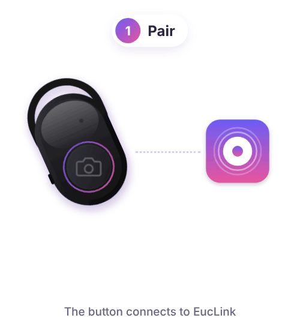
  
  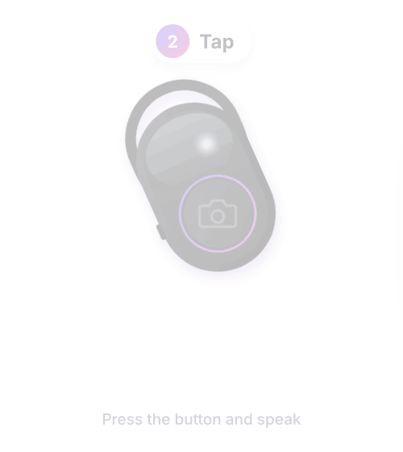
  
  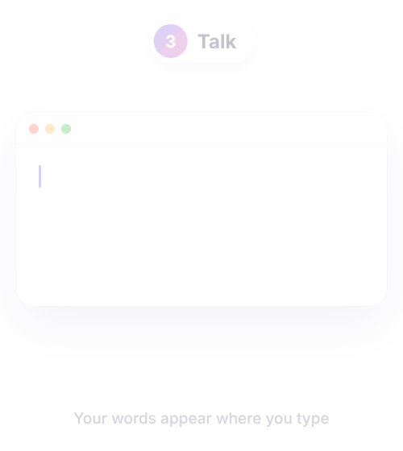
</p>

EucLink is a small menu bar app. It takes hold of your Bluetooth clicker, so the key the clicker
sends (often Volume Up) never reaches other apps. Then it runs the action you chose. A setup
guide walks you through every macOS permission and shows when each one is on.

## The button

<p align="center"></p>

EucLink was built and tested with a cheap Bluetooth camera-shutter remote like the one above,
the kind sold for taking selfies with a phone. Presentation clickers and other small Bluetooth
remotes work the same way.

A remote like this reports a short name when it pairs, for example **BT1818** or **AB Shutter3**.
That name is what you see in Bluetooth settings and in EucLink's list of devices. macOS treats
the remote as an HID device: a tiny keyboard that sends one key, usually Volume Up. EucLink
does not care about the name or the key; it learns whichever your remote sends.

The setup pictures below are drawn by the app itself with sample data, so the remote there is
called AB Shutter3. Buttons and switches look slightly different on your Mac, where they follow
your macOS version.

## What EucLink does, and what it needs

**EucLink does not transcribe or chat by itself.** It turns a button press into a keystroke,
an app launch, a Shortcut, a link or a command. The work happens in another app that you
already use. For voice input that is a dictation app, for example:

- [Handy](https://github.com/cjpais/Handy), free and open source. EucLink was built and tested
  with it.
- Superwhisper, Wispr Flow, MacWhisper or similar apps that start dictation from a shortcut.

Any app works if it can be started with a keyboard shortcut, a link or a Shortcut.

### The shortcut must be a global shortcut

EucLink presses keys the same way your keyboard does. For this to work while you are in
another app, the target app's shortcut must be a **global shortcut**: one the app registers
system-wide, so it works even when that app is not in front.

1. Open the target app's settings and find its global shortcut. Dictation apps usually call it
   the recording, transcription or push-to-talk shortcut.
2. Pick a combination that no other app uses, for example `fn + Space` or `⌥ + Space`.
3. In EucLink, record exactly that combination.
4. Match how the app behaves:
   - The app records while the key is held: choose **Push-to-talk** (Hold).
   - The app starts on one press and stops on the next: choose **Tap to start and stop**.

Shortcuts that only work while their app is in front, such as menu shortcuts, will not work
from the button. EucLink can only trigger what the target app listens for globally.

### How this started: Karabiner-Elements

EucLink began as a [Karabiner-Elements](https://github.com/pqrs-org/Karabiner-Elements) setup.
Karabiner remapped the clicker's key to the dictation shortcut, and that setup kept breaking
after reconnects and macOS updates. EucLink replaces it with one app. It takes hold of the
button itself and shows which part failed when something stops working.

You do not need Karabiner-Elements. If you have it installed, it can keep running for your other
keyboards. Turn off **Modify events** for the button in Karabiner-Elements > Devices, so that
EucLink can take hold of it.

## Before you start

- macOS 13 or later.
- To build it yourself: the Xcode command line tools (`xcode-select --install`).
- A Bluetooth button paired with your Mac in System Settings > Bluetooth. Camera shutter
  remotes and presentation clickers work.
- Your target app installed, with a global shortcut set as described above.

## Install

### Download (Apple silicon)

1. Download the `.dmg` from the latest [release](../../releases/latest) and open it.
2. Drag **EucLink** into **Applications**. (The release also has a `.zip` of the same app.)
3. Allow the first launch, with either option below. You only do this once.

**Why macOS blocks it.** Apple only lets an app open without a warning if a paid Apple developer
account has signed and notarized it. EucLink is a free project without one, so macOS stops the
first launch. The app is the same one built from this code by GitHub Actions. If you would
rather not trust a download, [build it yourself](#build-it-yourself-any-mac).

**Option A: Open Anyway (no Terminal)**

<p align="center">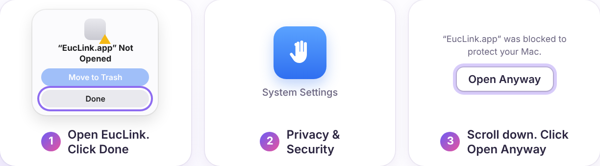 Privacy & Security, scroll down and click Open Anyway"></p>

1. Double-click **EucLink** in Applications. macOS says "EucLink.app" Not Opened. Click **Done**,
   not Move to Trash.

   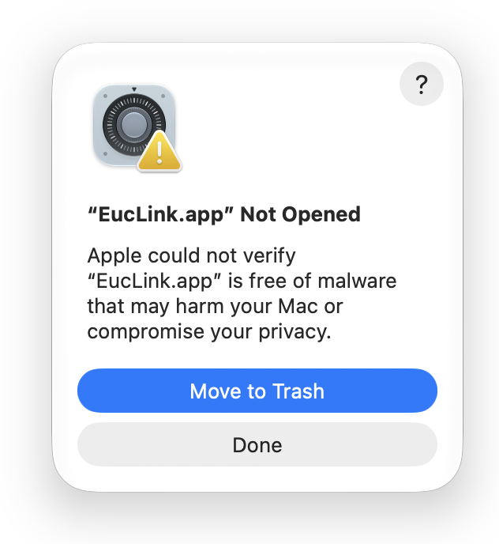

2. Open **System Settings** and click **Privacy & Security** in the sidebar.

   

3. Scroll down to the message "EucLink.app" was blocked to protect your Mac, and click
   **Open Anyway**.

   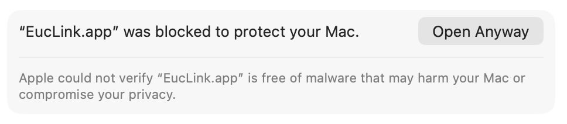

4. Enter your password, then click **Open Anyway** again.

**Option B: Terminal**

Open Terminal (press **Cmd+Space**, type `Terminal`, press **Return**), paste this line, and press
**Return**. It removes the "downloaded from the internet" label from EucLink only:

```bash
xattr -dr com.apple.quarantine /Applications/EucLink.app
```

Then open EucLink from Applications.

### Build it yourself (any Mac)

Clone or download this repository, then run this in its folder:

```bash
./build.sh
```

`build.sh` compiles the app, installs it in `/Applications` and opens it. The setup guide opens on
first launch. Building it yourself avoids the Gatekeeper warning and works on Intel Macs too.

## Set up, step by step

The guide has nine steps and one main button. The button is the step's own action, such as
**Allow Bluetooth**. When macOS reports the step done, the step shows a green confirmation,
for example "Bluetooth allowed. 1 of 3 permissions done", and the button becomes **Continue**.
Nothing moves until you click it. The bar at the top shows where you are, with a tick for
each step done. You can close the guide and pick up later from the menu bar dot under
**Setup Guide**.

### 1. Welcome

The guide lists what you need. If EucLink is not in Applications, it offers to copy itself there
first. macOS ties permissions to the app's location, so do this before granting anything.

<p align="center">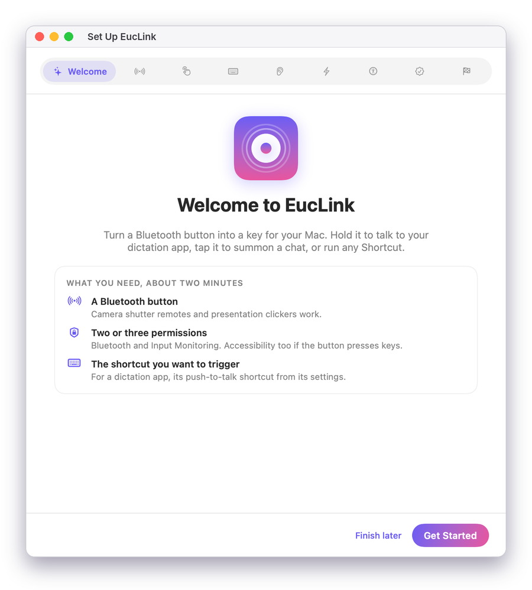</p>


### 2. Allow Bluetooth

Click **Allow Bluetooth**, the main button at the bottom, then **Allow** in the macOS prompt.
EucLink only uses this to see whether your button is connected or asleep.

<p align="center">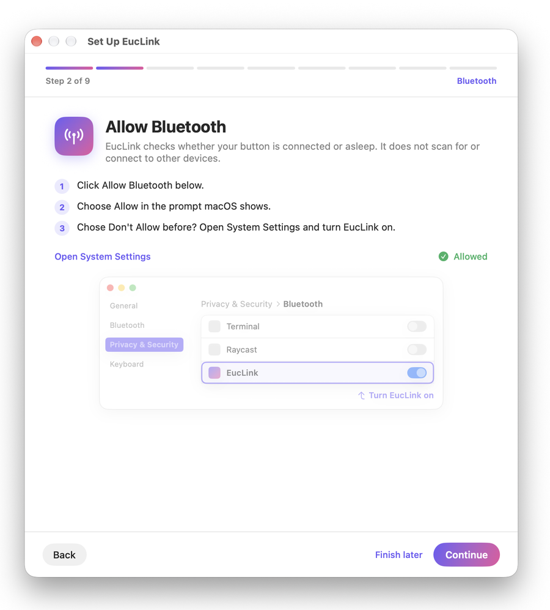</p>

A green card confirms it and counts the permissions done. Click **Continue**.

<p align="center">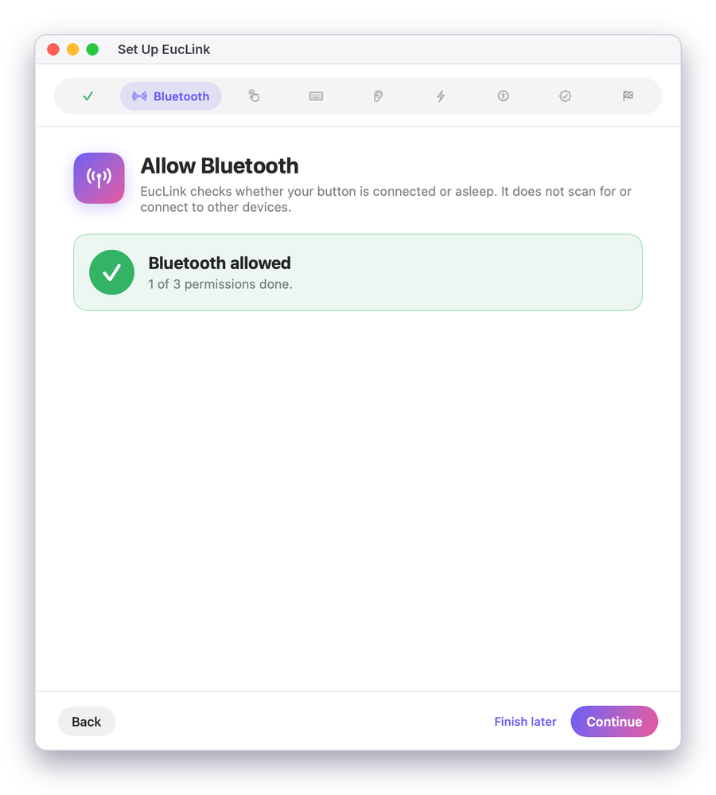</p>


### 3. Choose your button

Press your button once. Most clickers connect only when pressed, so it moves to **Connected now**.
Select it, then click **Continue**. The picture shows sample devices.

<p align="center">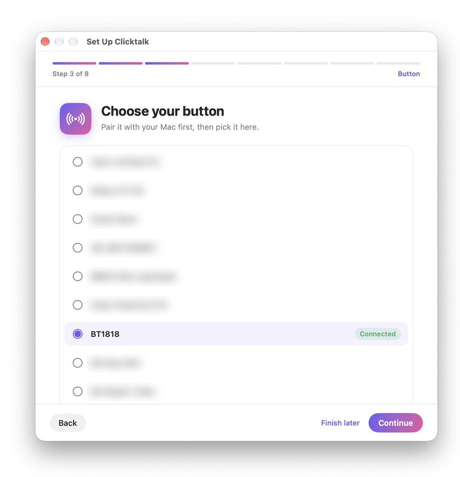</p>

### 4. Allow Input Monitoring

1. Click **Allow Input Monitoring**. System Settings opens on the Input Monitoring list.
2. Find **EucLink** in the list. **Not there?** Drag the dashed EucLink icon from the guide into
   the list. See [If EucLink is not in the list](#if-euclink-is-not-in-the-list).
3. Turn EucLink on. If macOS asks to quit and reopen EucLink, choose **Later**.
4. Click **Restart EucLink** in the guide. It reopens on the same step, now allowed.
5. Still says **Turned off** although the switch is on? Click **Reset and Try Again** in the guide.

When the step is done, a green note says that EucLink now holds your button.

<p align="center">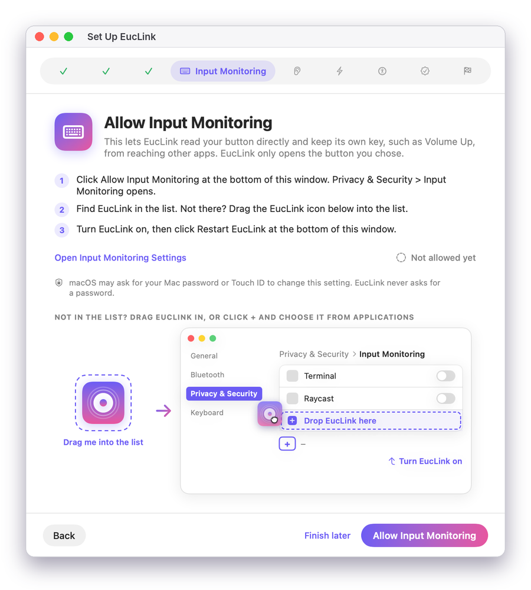</p>

### 5. Press your button

Press the button once. EucLink learns which key the button sends, for example Volume Up, and shows
its name. Every clicker is different, so this replaces any device list.

<p align="center">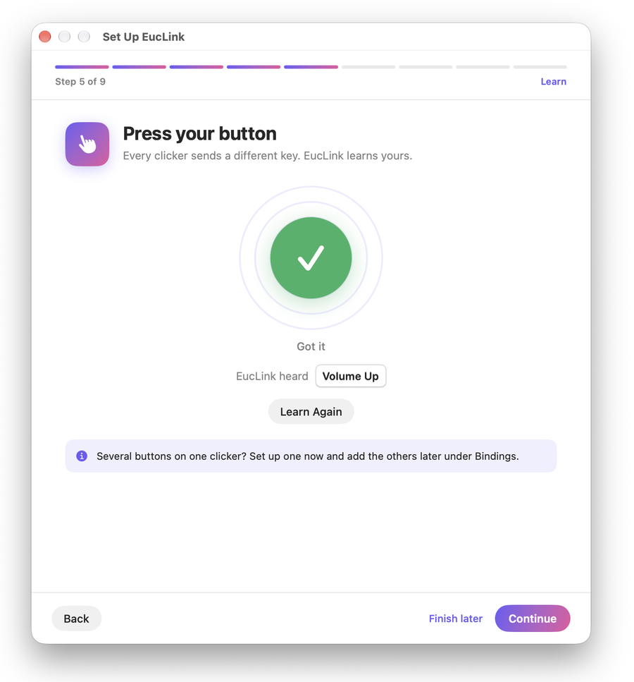</p>


### 6. Choose what it does

Pick a starting point, then fill in the details:

- **Push-to-talk dictation.** Record the dictation app's global shortcut. The key stays down while
  you hold the button.
- **Tap to start and stop.** Same, as a single tap.
- **Summon an app.** Pick the app. A second press hides it.
- **Run a Shortcut.** Pick one from the Shortcuts app.
- **Something else.** A link or a shell command.

To record a shortcut, click **Record Shortcut** and press the combination. The target app reacts once
while you record it; that is expected. You can also click **Type it instead** and write it, for
example `fn+space` or `right option`.

<p align="center">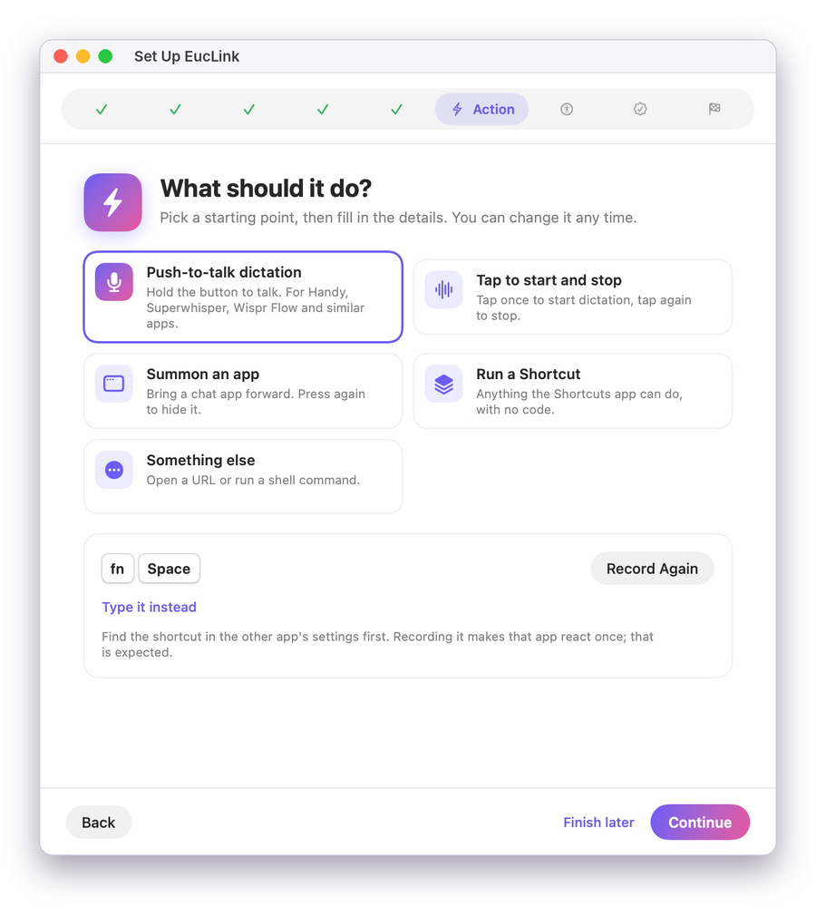</p>

### 7. Allow Accessibility

Only needed when the button presses keys. For other actions the step says it is not needed.

1. Click **Allow Accessibility**. System Settings opens on the Accessibility list.
2. Find **EucLink** in the list. **Not there?** Drag the dashed EucLink icon from the guide into
   the list, as in [this animation](#if-euclink-is-not-in-the-list).
3. Turn EucLink on. This one works without a restart.

<p align="center"></p>

### 8. Try it

Press the button. For push-to-talk, hold it, speak, then let go. The step turns green with
**It works**, and shows what the press did. If nothing happens, wake the button with a press, and
check that the recorded shortcut matches the target app's global shortcut.

<p align="center"></p>

### 9. Done

**Open EucLink at login** is on by default, so the button works right after you log in. Turn
it off here if you prefer to start EucLink yourself.

<p align="center">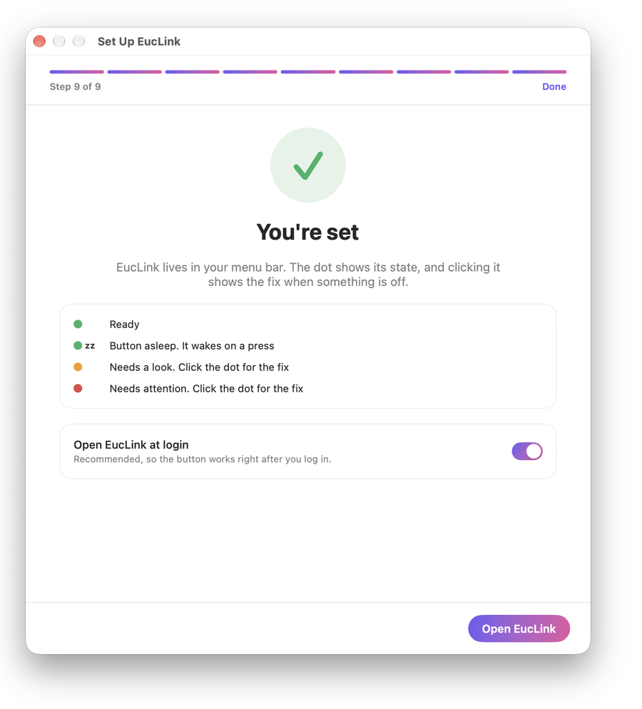</p>

## Permissions

EucLink asks for three macOS permissions. The guide asks for each one on its own step, and
only when you click its **Allow** button.

| Permission | Guide step | Why EucLink needs it | Needed |
|---|---|---|---|
| Bluetooth | 2 | To see whether your button is connected or asleep | Always |
| Input Monitoring | 4 | To read your button and keep its own key, often Volume Up, from reaching other apps | Always |
| Accessibility | 7 | To press keys for you, such as fn+Space for your dictation app | Only when the button presses keys |

EucLink never asks for screen recording, the microphone, the camera or full disk access. It
goes online for one thing only, an optional update check that is off by default. See
[Privacy](#privacy).

**Passwords.** EucLink never asks for a password. macOS itself asks for your Mac password or
Touch ID in two places: when you click **Open Anyway** for the first launch, and when you change
a switch or click **+** in Privacy & Security. If any other password prompt names EucLink, click
**Deny** and [report it](../../issues/new?template=bug_report.yml).

### If EucLink is not in the list

macOS does not always add EucLink to the Input Monitoring or Accessibility list by itself.
Drag it in:

<p align="center">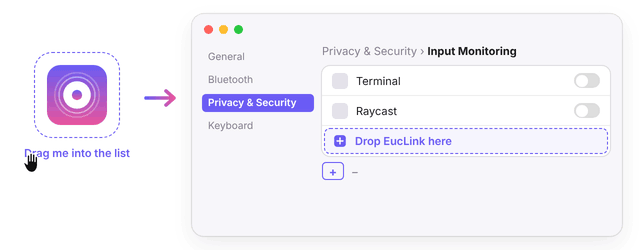</p>

1. Keep the guide and System Settings side by side.
2. Drag the dashed EucLink icon from the guide into the list.
3. Turn EucLink on.

Or click **+** below the list, press **Cmd+Shift+A** to jump to Applications, choose EucLink
and click **Open**.

### If the switch is on but EucLink says "Turned off"

macOS ties each permission to one exact build of the app. After you switch between a
downloaded EucLink and one you built, the switch you see can belong to the other copy.

1. Click **Reset and Try Again** in the guide, or **Reset Permissions and Relaunch** under
   EucLink > Permissions. EucLink clears its entry and restarts.
2. Click **Allow** again and turn EucLink on.
3. Still on after the reset? Select EucLink in the System Settings list, click **−**, and
   allow it again. EucLink tells you when this is needed.

## Everyday use

### The menu bar dot

| Dot | Label | Meaning |
|---|---|---|
| green | | Ready |
| green | zz | Button asleep between presses; it wakes on a press |
| red | BT | Bluetooth off, button not paired, or disconnected |
| yellow | HID | Connected, but macOS has not registered it as an input device yet |
| red | PERM | A permission is missing |
| yellow | BIND | No binding, a binding without an action, or a binding changed outside the app |
| yellow | BTN | Your button choice changed outside the app; choose it again |
| yellow | GRAB | Another app, often Karabiner-Elements, holds the button |
| grey | ? | Not set up |

Click the dot for the diagnosis and a one-click fix.

### The window

Open it from the menu bar dot with **Open EucLink**.

<p align="center">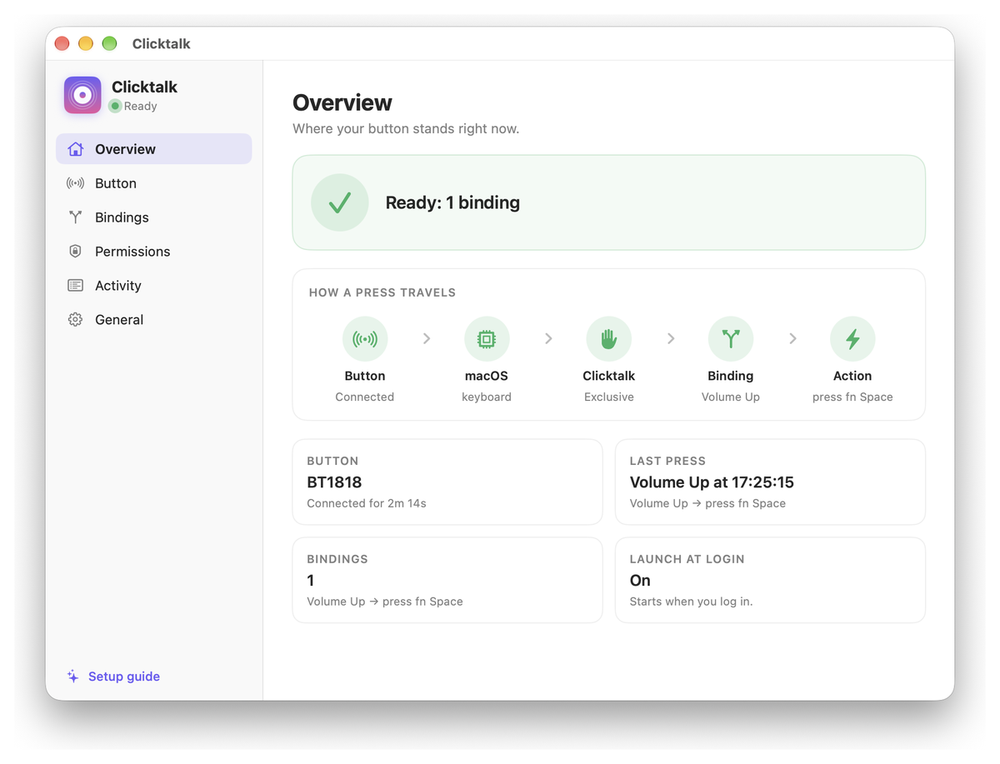</p>

- **Overview.** The current state, the fix that matters, and the path a press takes.
- **Button.** Choose the device, mark it as one that sleeps between presses, reconnect.
- **Bindings.** One binding per physical button: learn a press, choose its action, test it.
- **Permissions.** Each permission with its state, an Allow button and reset commands.
- **Activity.** Every connection, press and result, newest first.
- **General.** Open at login, the setup guide, about.

### What a press can do

| Action | You supply | Good for |
|---|---|---|
| Keystroke, hold | the target app's global shortcut | push-to-talk dictation |
| Keystroke, press | the target app's global shortcut | tap-to-toggle dictation, app hotkeys |
| Toggle app | an app | summon a chat app, press again to hide it |
| Open app | an app | always bring it forward |
| Run a Shortcut | a Shortcut | anything the Shortcuts app can do |
| URL | a link | web chats, `shortcuts://`, app links |
| Command | a shell command | scripts |

### Gestures: press, double press, long press

One button can do up to three things. For example, with a dictation app that starts and stops
on the same shortcut:

| Gesture | Action | What it does |
|---|---|---|
| Press | Keystroke `fn Space`, press | Start dictation, then stop and paste |
| Double press | Keystroke `⌘ Return`, press | Send the message |
| Long press | Any action | For example, open your chat app |

To add one:

1. Open **EucLink > Bindings** and click **Add Binding**.
2. Press the same button. EucLink adds the next free gesture: double press, then long press.
3. Choose its action, and change the gesture under **Gesture** if you like.

A button with only a press acts the moment you press it. Once it also has a double or long
press, EucLink waits briefly, 0.3 seconds by default, to tell them apart, so a single press
runs a moment later. Set the wait under **Double and long press timing** on the Bindings page.
For push-to-talk on such a button, press, pause briefly, then talk.

## Troubleshooting

| Symptom | Fix |
|---|---|
| The button fires, but the target app does nothing | The shortcut is not the app's global shortcut, or another app uses the same one. Check the target app's settings and record it again. |
| Dot shows `GRAB` | Another app holds the button. In Karabiner-Elements > Devices, turn off Modify events for it. |
| Dot shows `PERM`, or a step says "Turned off", after you allowed everything | The switch belongs to another copy of EucLink. Click **Reset and Try Again** in the guide, or **Reset Permissions and Relaunch** under Permissions, then allow it again. |
| Red `BT` while the button still works | The button sleeps between presses. Turn on "Button sleeps between presses" under Button. |
| The first press after a while does nothing | The button was asleep and that press woke it. Press again. |

## Uninstall, and a clean reinstall

**From the app.** Open EucLink, go to **General** and click **Uninstall…**. After you confirm, it:

1. removes the login item;
2. deletes your bindings, settings and the keychain key that seals them;
3. resets its Bluetooth, Input Monitoring and Accessibility permissions;
4. moves the app to the Trash and quits.

Your Bluetooth pairing stays. If a step cannot finish, EucLink tells you the one thing to do by hand.

**From this folder**, if you built EucLink yourself:

```bash
./uninstall.sh
```

To go through the setup guide again as a new user would:

```bash
./uninstall.sh && ./build.sh
```

`./uninstall.sh --all` also deletes the "EucLink Dev" signing certificate described below. The
in-app uninstall leaves that certificate alone, because only people who build the app have it.

## For developers

### Building often

macOS ties the Input Monitoring and Accessibility grants to the app's signature. An ad hoc signature
changes on every build, so each rebuild drops both grants. If you change the code, run this once:

```bash
./make-cert.sh
```

It creates a self-signed code signing certificate in your login keychain. `build.sh` then uses it
automatically, and the grants survive rebuilds.

Each build asks to use the key. Click **Allow**, never **Always Allow**. Always Allow would let
any program running under your account sign itself as EucLink and inherit its permissions.

If you created the certificate with an older version of the script, check the key once. In
Keychain Access, open the EucLink Dev private key, go to Access Control, and empty the
"Always allow access by these applications" list.

### Tests

`./build.sh ci` builds the app without installing it and runs the tests in `Tests/main.swift`.
GitHub Actions runs the same command on every push and pull request.

### Making the disk image

`dmg/make.sh EucLink.dmg` packs a built `EucLink.app` into a disk image with the
drag-to-Applications window. The background is drawn in `dmg/background.html` and saved as
`dmg/background.png` and `@2x`. CI builds the image on every push, and the release workflow
attaches it to each release with the install steps from `.github/release-install.md`.

### Rendering the guide images

`./build.sh docs` renders every guide step from the app's own views with sample data into
`docs/images/guide-*.png`. The Build workflow renders the same pictures on every push and
uploads them as the `guide-pictures` artifact. The step pictures in this README are those
renders with a window frame added.

### How it works

- IOBluetooth for pairing and connection state. CoreBluetooth only asks for permission.
- IOHIDManager opens each of the button's HID interfaces with the seize option, the same mechanism
  Karabiner-Elements uses. If another app holds the button, EucLink listens instead and says so.
- Presses are learned from real input, so unusual clickers need no device list.
- Keystrokes are posted with CGEvent, modifiers as real key presses, which is what push-to-talk apps
  watch for. This is why Accessibility is needed.
- SwiftUI for the window and guide, AppKit for the menu bar item. Settings live in
  `~/Library/Preferences/local.euclink.plist`. The only network code is the optional update
  check in `Sources/Updates.swift`, and `./build.sh ci` fails if any appears elsewhere.

## Security notes

EucLink holds two powerful macOS permissions: Input Monitoring and Accessibility. It protects
them in five ways:

- **Hardened runtime.** `build.sh` signs the app with the hardened runtime, so other programs
  cannot inject code into it to borrow those permissions.
- **Key used only with your consent.** The certificate from `make-cert.sh` trusts no app to use
  its key silently, so every signing asks you. This matters because macOS identifies EucLink
  only by its name and this certificate: anyone who can sign with the key can pose as EucLink.
- **Recording only on request.** The shortcut recorder listens only while you record, and
  stops after one shortcut.
- **Sealed settings.** Any program running under your account can edit EucLink's settings
  file. So when you change a binding or choose your button in the app, EucLink seals the new
  value with a secret key that only it can read from your keychain. A binding that changed
  outside the app does not run until you approve it under Bindings. A button choice that changed
  outside the app is ignored until you choose your button again.
- **Only your button is opened.** EucLink opens a device only if it is the Bluetooth button you
  chose, and release builds do not print key presses anywhere.

If EucLink reports a binding or button choice that changed outside the app and you did not
change it, remove it and check your Mac for unwanted software.

After each update, EucLink asks once: choose your button again under Button, and approve your
bindings under Bindings. macOS lets only the exact build that created the sealing key read it,
and without an Apple developer signature every update is a different build. EucLink never asks
for your keychain password; it starts a new key and has you confirm your settings instead.

## Privacy

EucLink is built privacy first. The full policy is in [PRIVACY.md](PRIVACY.md).

- No accounts, analytics or telemetry.
- It reads one device, the button you chose, and never your keyboard. The shortcut recorder
  is the one exception: it listens for at most ten seconds, only while you record.
- Your settings stay on your Mac. Activity is kept in memory and gone when you quit.
- It goes online only for the update check, and only if you turn it on.

## Updates

EucLink does not update itself. In **General** you can:

- click **Check Now** to ask GitHub whether a newer version exists;
- turn on **Check for updates when EucLink opens**, which is off by default;
- click **See Latest Release on GitHub** to look in your browser instead.

When a newer version exists, EucLink shows a message with a button that opens the download
page. You install it like the first time. macOS treats each update as a new app, so allow
Input Monitoring and Accessibility again, then choose your button and approve your binding.

To get an email for each new version instead, click **Watch > Custom > Releases** on GitHub.

Each release page lists SHA-256 checksums. To check a download:

```bash
shasum -a 256 ~/Downloads/EucLink-*.dmg
```

## Limits

- The first press after a long sleep may only wake the button. That is the button's firmware.
- The app is not notarized. Building it yourself avoids the Gatekeeper warning.
- The downloadable app is for Apple silicon. On an Intel Mac, build it yourself.

## Getting help

- Something not working? Click the menu bar dot first: it names the failing part and offers a fix.
  Then check [Troubleshooting](#troubleshooting).
- Still stuck: open a [bug report](../../issues/new?template=bug_report.yml).
- Tell others whether your button works with a [button report](../../issues/new?template=button_report.yml).
- Security problems: see [SECURITY.md](SECURITY.md). Please do not open a public issue.

## Contributing

Bug reports, button reports, docs and code are all welcome. See [CONTRIBUTING.md](CONTRIBUTING.md)
and the [code of conduct](CODE_OF_CONDUCT.md). Changes are listed in [CHANGELOG.md](CHANGELOG.md).

## Maintainer

Maintained by [@vilbht](https://github.com/vilbht). Reviews pull requests, triages issues and
handles security reports.

## Credits

- [Karabiner-Elements](https://github.com/pqrs-org/Karabiner-Elements) by pqrs.org, which this
  project started from.
- [Handy](https://github.com/cjpais/Handy), the dictation app EucLink was built and tested with.

## License

[MIT](LICENSE).
